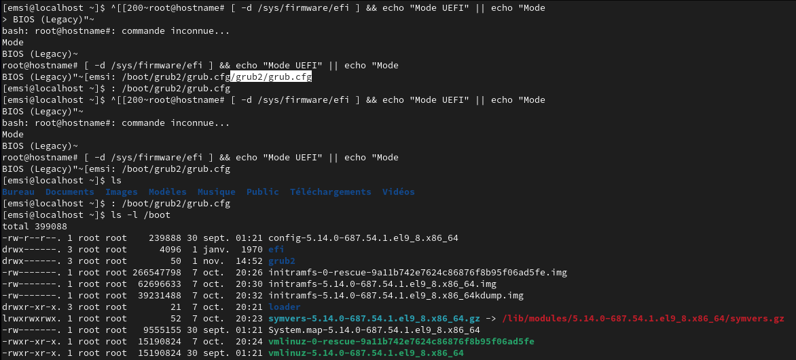
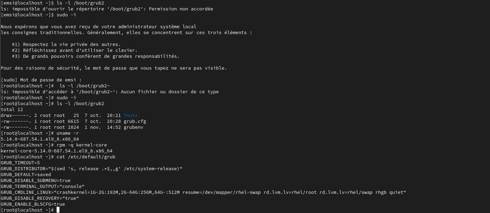
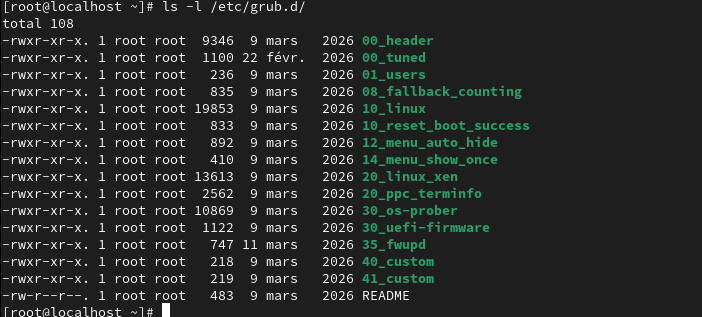
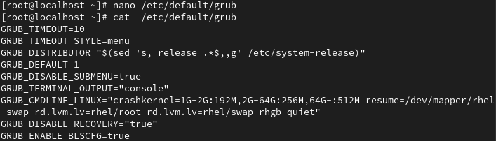
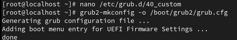
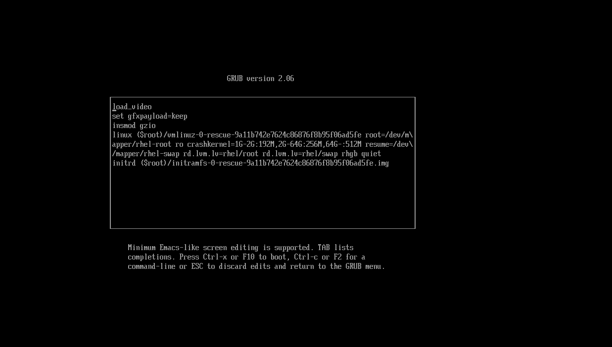
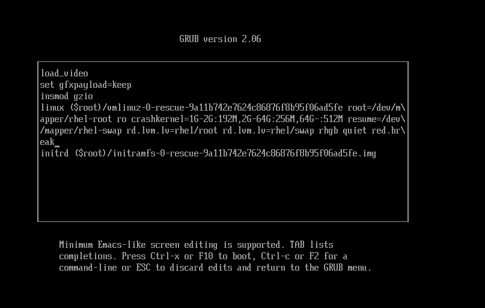
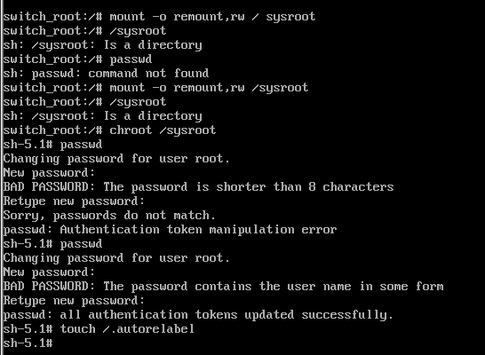
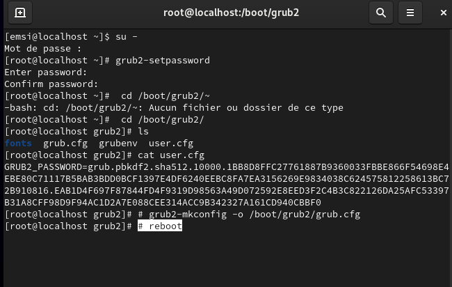
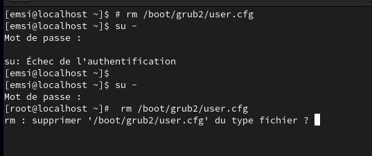

# TP n°2 – Configuration du Boot Loader GRUB2


| | |
|---|---|
| **École** | EMSI – École Marocaine des Sciences de l'Ingénieur |
| **Module** | Administration Unix – 4IIR |
| **Encadrante** | Mme. Berraho Sanae |
| **Réalisé par** | *[Nom Prénom]* |
| **Année universitaire** | 2026/2027 |
| **Date de réalisation** | 01/11/2026 |
| **Environnement** | Red Hat Enterprise Linux 9 (noyau `5.14.0-687.54.1.el9_8.x86_64`), GRUB 2.06 |

---

## Table des matières

1. [Objectifs](#1-objectifs)
2. [Partie 1 – Découverte de GRUB2 et du processus de démarrage](#2-partie-1--découverte-de-grub2-et-du-processus-de-démarrage)
3. [Partie 2 – Analyse de la configuration de GRUB2](#3-partie-2--analyse-de-la-configuration-de-grub2)
4. [Partie 3 – Génération et modification de la configuration](#4-partie-3--génération-et-modification-de-la-configuration)
5. [Partie 4 – Réinitialisation du mot de passe root](#5-partie-4--réinitialisation-du-mot-de-passe-root)
6. [Partie 5 – Protection de GRUB par mot de passe](#6-partie-5--protection-de-grub-par-mot-de-passe)
7. [Conclusion](#7-conclusion)
8. [Structure du dépôt](#8-structure-du-dépôt)

---

## 1. Objectifs

- Comprendre le rôle de GRUB2 dans la séquence de démarrage de RHEL 9.
- Comprendre comment le fichier `grub.cfg` est **généré** (et non édité directement) à partir de `/etc/default/grub` et `/etc/grub.d/`.
- Personnaliser le menu de démarrage (délai, entrée par défaut, entrées personnalisées).
- Réinitialiser le mot de passe `root` via l'interface GRUB (`rd.break`).
- Sécuriser GRUB avec un mot de passe.

**Principe de génération :**

```
/etc/default/grub ─┐
                   ├──► grub2-mkconfig ──► /boot/grub2/grub.cfg
/etc/grub.d/*  ────┘
```

---

## 2. Partie 1 – Découverte de GRUB2 et du processus de démarrage

### 2.1 Identification du mode de démarrage (BIOS / UEFI)

Commande prévue par le TP :

```bash
[ -d /sys/firmware/efi ] && echo "Mode UEFI" || echo "Mode BIOS (Legacy)"
```

| Mode | Fichier de configuration |
|------|--------------------------|
| BIOS | `/boot/grub2/grub.cfg` |
| UEFI | `/boot/efi/EFI/redhat/grub.cfg` (fichier relais vers `/boot/grub2/grub.cfg`) |

> **Remarque :** sur la capture ci-dessous, la commande a été saisie avec un retour à la ligne dans la chaîne `echo`, ce qui a provoqué l'affichage de « Mode BIOS (Legacy) » sans réel test de `/sys/firmware/efi`. Par ailleurs, la présence du répertoire `/boot/efi` et de l'entrée *UEFI Firmware Settings* ajoutée par `grub2-mkconfig` (voir partie 3) indique plutôt un démarrage en **UEFI**. Dans tous les cas, la configuration principale utilisée dans ce TP est `/boot/grub2/grub.cfg`.

### 2.2 Contenu de `/boot`

```bash
ls -l /boot
ls -l /boot/grub2
```



Éléments identifiés :

| Élément | Rôle |
|---------|------|
| `vmlinuz-5.14.0-687.54.1.el9_8.x86_64` | Noyau Linux compressé |
| `initramfs-5.14.0-687.54.1.el9_8.x86_64.img` | Système de fichiers racine temporaire utilisé au démarrage |
| `vmlinuz-0-rescue-…` / `initramfs-0-rescue-…` | Noyau et initramfs de secours |
| `loader/` | Contient `entries/` : entrées de démarrage au format BLS |
| `grub2/` | `grubenv`, polices, `grub.cfg` |
| `efi/` | Partition système EFI |
| `config-…`, `System.map-…`, `symvers-…` | Fichiers de configuration et symboles du noyau |

### 2.3 Contenu de `/boot/grub2` et noyau en cours d'exécution

L'accès à `/boot/grub2` est refusé à l'utilisateur standard (`emsi`) : le répertoire est en `drwx------` et appartient à `root`. Il faut donc passer en root avec `sudo -i`.

```bash
sudo -i
ls -l /boot/grub2
uname -r
rpm -q kernel-core
cat /etc/default/grub
```



Résultats :

- `/boot/grub2` contient : `fonts/`, `grub.cfg`, `grubenv`.
- Noyau en cours d'exécution (`uname -r`) : `5.14.0-687.54.1.el9_8.x86_64`.
- Noyau installé (`rpm -q kernel-core`) : `kernel-core-5.14.0-687.54.1.el9_8.x86_64` → le noyau actif correspond au noyau installé.

---

## 3. Partie 2 – Analyse de la configuration de GRUB2

### 3.1 Fichier `/etc/default/grub` (valeurs initiales)

| Variable | Valeur initiale | Rôle |
|----------|-----------------|------|
| `GRUB_TIMEOUT` | `5` | Délai d'affichage du menu avant démarrage automatique |
| `GRUB_DISTRIBUTOR` | `$(sed 's, release .*$,,g' /etc/system-release)` | Nom de la distribution dans le titre des entrées |
| `GRUB_DEFAULT` | `saved` | Entrée par défaut lue dans `grubenv` |
| `GRUB_DISABLE_SUBMENU` | `true` | Les anciens noyaux ne sont pas placés dans un sous-menu |
| `GRUB_TERMINAL_OUTPUT` | `console` | Type de sortie du terminal GRUB |
| `GRUB_CMDLINE_LINUX` | `crashkernel=… resume=/dev/mapper/rhel-swap rd.lvm.lv=rhel/root rd.lvm.lv=rhel/swap rhgb quiet` | Paramètres ajoutés à la ligne de commande des noyaux |
| `GRUB_DISABLE_RECOVERY` | `"true"` | Désactive la génération des entrées de secours |
| `GRUB_ENABLE_BLSCFG` | `true` | Utilise la Boot Loader Specification (BLS) |

### 3.2 Scripts de `/etc/grub.d/`

```bash
ls -l /etc/grub.d/
```



`grub2-mkconfig` exécute ces scripts dans l'ordre alphabétique :

| Script | Rôle |
|--------|------|
| `00_header` | Variables de base : entrée par défaut, délai, terminal, chargement de `grubenv` |
| `00_tuned` | Paramètres liés au profil `tuned` |
| `01_users` | Prend en compte le mot de passe défini avec `grub2-setpassword` |
| `08_fallback_counting` | Gestion du comptage de démarrages (fallback) |
| `10_linux` | Génère les entrées des noyaux Linux via `blscfg` (BLS) |
| `10_reset_boot_success` | Réinitialise l'indicateur `boot_success` |
| `12_menu_auto_hide` | Masquage automatique du menu |
| `14_menu_show_once` | Affichage du menu une seule fois |
| `20_linux_xen` / `20_ppc_terminfo` | Support Xen / PowerPC |
| `30_os-prober` | Détection des autres systèmes d'exploitation |
| `30_uefi-firmware` | Entrée d'accès à la configuration du firmware UEFI |
| `35_fwupd` | Entrées liées à mise à jour du firmware |
| `40_custom` | Entrées de menu personnalisées |
| `41_custom` | Inclusion de `custom.cfg` s'il existe |

---

## 4. Partie 3 – Génération et modification de la configuration

### 4.1 Sauvegarde préalable

Une erreur dans la configuration de GRUB peut empêcher le démarrage : les fichiers concernés sont sauvegardés avant modification.

```bash
cp -p /etc/default/grub        /root/grub.default.bak
cp -p /etc/grub.d/40_custom    /root/40_custom.bak
cp -p /boot/grub2/grub.cfg     /root/grub.cfg.bak
```

### 4.2 Modification du délai, du style et de l'entrée par défaut

```bash
nano /etc/default/grub
```

Modifications apportées :

```ini
GRUB_TIMEOUT=10
GRUB_TIMEOUT_STYLE=menu
GRUB_DEFAULT=1
```



| Variable | Avant | Après | Effet |
|----------|-------|-------|-------|
| `GRUB_TIMEOUT` | `5` | `10` | Menu affiché 10 secondes |
| `GRUB_TIMEOUT_STYLE` | *(absente)* | `menu` | Force l'affichage du menu |
| `GRUB_DEFAULT` | `saved` | `1` | Démarre sur la 2ᵉ entrée du menu |

> `GRUB_DEFAULT=0` → 1ʳᵉ entrée, `GRUB_DEFAULT=1` → 2ᵉ entrée, `GRUB_DEFAULT=saved` → entrée enregistrée dans `grubenv`.

### 4.3 Ajout d'entrées « Redémarrer » et « Arrêter » dans `40_custom`

```bash
nano /etc/grub.d/40_custom
```

```bash
menuentry "Redemarrer" {
    echo "Redemarrer le systeme..."
    reboot
}
menuentry "Arreter le systeme" {
    echo "Arret du systeme..."
    halt
}
```

### 4.4 Régénération de `grub.cfg`

```bash
grub2-mkconfig -o /boot/grub2/grub.cfg
```



La sortie confirme la génération du fichier et l'ajout de l'entrée *UEFI Firmware Settings* par le script `30_uefi-firmware`.

### 4.5 Vérification après redémarrage

Après `reboot`, le menu GRUB doit afficher :

- le menu pendant 10 secondes,
- la 2ᵉ entrée présélectionnée,
- les entrées personnalisées **Redemarrer** et **Arreter le systeme**.

---

## 5. Partie 4 – Réinitialisation du mot de passe root

GRUB dispose d'une interface d'édition permettant de modifier la ligne de démarrage du noyau, ce qui permet de récupérer un mot de passe `root` perdu.

### 5.1 Accès à l'éditeur GRUB

Au menu GRUB, sélectionner l'entrée voulue puis appuyer sur la touche **`e`**.



La ligne qui commence par `linux ($root)/vmlinuz-…` charge le noyau avec ses paramètres.

### 5.2 Ajout du paramètre `rd.break`

On ajoute `rd.break` à la fin de la ligne `linux`. Ce paramètre **interrompt le démarrage avant que `initramfs` ne passe la main à `systemd`**, ce qui donne un shell root minimal.



Démarrage avec la configuration modifiée : **Ctrl + X** (ou F10).

### 5.3 Remontage de `/sysroot`, `chroot` et changement du mot de passe

```bash
mount -o remount,rw /sysroot
chroot /sysroot
passwd
touch /.autorelabel
```



Déroulement observé :

1. Remontage de `/sysroot` en lecture/écriture, puis `chroot /sysroot` (prompt `sh-5.1#`).
2. Première tentative de `passwd` : refusée (`BAD PASSWORD: The password is shorter than 8 characters`, puis mots de passe non identiques → *Authentication token manipulation error*).
3. Deuxième tentative : le mot de passe est accepté (`all authentication tokens updated successfully`), malgré un avertissement de robustesse.
4. `touch /.autorelabel` : planifie le **re-labelling SELinux** au prochain démarrage. Il est nécessaire car `passwd` recrée `/etc/shadow` sans contexte SELinux.

### 5.4 Sortie et vérification

```bash
exit
exit
```

Le système redémarre (le re-labelling peut prendre quelques minutes), puis on vérifie la connexion avec le nouveau mot de passe `root`.

---

## 6. Partie 5 – Protection de GRUB par mot de passe

### 6.1 Pourquoi protéger GRUB ?

- **Empêcher l'accès au mode single-user** : un attaquant pourrait devenir `root` (comme montré en partie 4).
- **Empêcher l'accès à la console GRUB** : modification de la configuration, lecture de fichiers avec `cat`.
- **Empêcher le démarrage de systèmes non sécurisés** en cas de double boot.

### 6.2 Définition du mot de passe GRUB

```bash
su -
grub2-setpassword
cd /boot/grub2/
ls
cat user.cfg
grub2-mkconfig -o /boot/grub2/grub.cfg
reboot
```



- `grub2-setpassword` crée le fichier `/boot/grub2/user.cfg` contenant le mot de passe **haché** (PBKDF2-SHA512, 10 000 itérations) sous la forme `GRUB2_PASSWORD=grub.pbkdf2.sha512.10000.…`.
- Le répertoire contient désormais : `fonts`, `grub.cfg`, `grubenv`, `user.cfg`.
- `grub2-mkconfig` régénère `grub.cfg` ; le script `01_users` prend en compte le mot de passe.

> Une première tentative de `cd /boot/grub2/~` a échoué (`Aucun fichier ou dossier de ce type`) : simple faute de frappe, corrigée avec `cd /boot/grub2/`.

### 6.3 Vérification

Après redémarrage, appuyer sur **`e`** dans le menu GRUB : le nom d'utilisateur (`root`) et le mot de passe GRUB sont demandés avant toute modification.

### 6.4 Suppression de la protection

La protection se retire en supprimant le fichier `user.cfg` :

```bash
rm /boot/grub2/user.cfg
```



Sur la capture : la commande exécutée avec l'utilisateur `emsi` n'a aucun effet (droits insuffisants), puis la commande est relancée après `su -` ; le système demande la confirmation (`supprimer … du type fichier ?`), à valider par `o`/`y`.

> Selon la procédure du TP, il convient ensuite de régénérer `grub.cfg` pour que la configuration soit cohérente.

---

## 7. Conclusion

Ce TP a permis de :

- comprendre que `grub.cfg` **est généré** par `grub2-mkconfig` à partir de `/etc/default/grub` et des scripts de `/etc/grub.d/` ;
- personnaliser le comportement du menu (délai, entrée par défaut, entrées « Redémarrer » / « Arrêter ») ;
- constater, par la réinitialisation du mot de passe `root` avec `rd.break`, qu'un accès physique au menu GRUB suffit à obtenir les droits administrateur ;
- mettre en place et retirer une **protection par mot de passe GRUB** (`grub2-setpassword`), mesure essentielle de durcissement.

**Bonnes pratiques retenues :** sauvegarder les fichiers avant toute modification, ne jamais éditer `grub.cfg` directement, penser à `touch /.autorelabel` après un `passwd` en `chroot`, et protéger GRUB (idéalement avec le chiffrement de disque et un mot de passe BIOS/UEFI).

---

## 8. Structure du dépôt

```
TP2-GRUB2/
├── README.md                 ← ce compte rendu
├── configs/
│   ├── 40_custom             ← entrées personnalisées Redémarrer / Arrêter
│   └── default-grub          ← /etc/default/grub après modification
└── screenshots/
    ├── 01-detection-mode-et-contenu-boot.png
    ├── 02-grub2-noyau-et-default-grub.png
    ├── 03-scripts-grub-d.png
    ├── 04-modification-default-grub.png
    ├── 05-40custom-et-regeneration.png
    ├── 06-edition-entree-grub.png
    ├── 07-ajout-rd-break.png
    ├── 08-reinitialisation-mdp-root.png
    ├── 09-grub2-setpassword.png
    └── 10-suppression-user-cfg.png
```
