# TP n°3 – Configuration des cibles et gestion des services par Systemd

**Module :** Administration Unix (RHEL 9)
**Environnement :** VMware Workstation – Red Hat Enterprise Linux 9.8 (systemd 252)

## Objectif

Comprendre le fonctionnement de systemd, gérer les cibles (targets) et les services avec `systemctl`, consulter les journaux avec `journalctl`, et créer un service personnalisé.

## Structure du dépôt

```
TP3-Systemd/
├── README.md
├── configs/
│   ├── custom_service.sh          # script lancé par le service
│   └── custom_service.service     # unité systemd personnalisée
└── screenshots/                   # captures d'écran de chaque étape
```

---

## Atelier 1 – Bases de systemd et systemd-analyze

| Commande | Rôle |
|---|---|
| `systemctl --version` | Version de systemd (252) |
| `ps aux \| head -2` | Vérifier que le PID 1 est systemd |
| `whereis systemd` / `whereis systemctl` | Localiser les binaires et la configuration |
| `systemd-analyze` | Temps de démarrage (kernel + initrd + userspace) |
| `systemd-analyze blame` | Unités classées de la plus lente à la plus rapide |
| `systemd-analyze critical-chain` | Chaîne d'unités qui détermine la durée du boot |

**Résultats :**
- systemd 252 sur RHEL 9.
- Le PID 1 est `/usr/lib/systemd/systemd`.
- Démarrage en 14,966 s (3,588 s kernel + 2,935 s initrd + 8,441 s userspace).
- Service le plus lent : `plymouth-quit-wait.service` (3,9 s), suivi de `kdump.service` (3,7 s).

| Capture |
|---|
| 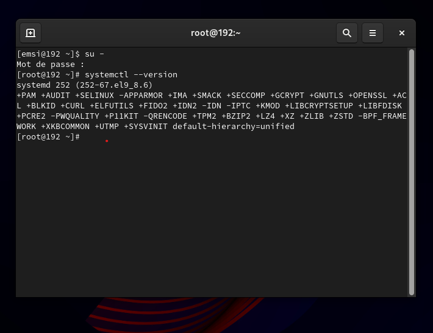 |
| 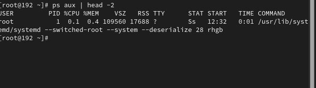 |
| 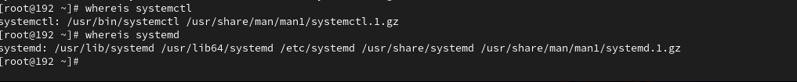 |
| 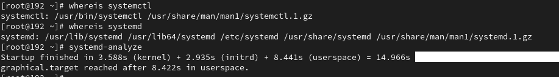 |
| 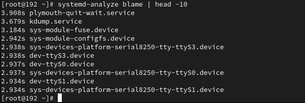 |
| 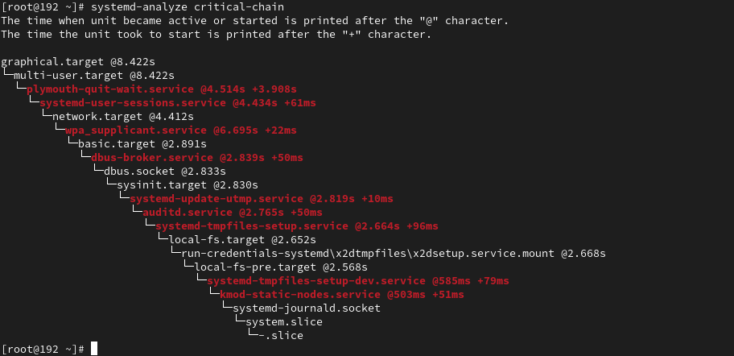 |

---

## Atelier 2 – Configuration des cibles

| Commande | Rôle |
|---|---|
| `systemctl get-default` | Cible par défaut (`graphical.target`) |
| `systemctl list-units --type target` | Cibles actives (22 unités) |
| `systemctl --failed` | Unités en échec (0) |
| `systemctl isolate multi-user.target` | Passer en mode texte immédiatement |
| `systemctl isolate graphical.target` | Revenir en mode graphique |
| `systemctl set-default multi-user.target` | Changer la cible par défaut (effet au prochain boot) |

**Résultats :**
- Cible par défaut : `graphical.target`, aucune unité en échec.
- `isolate multi-user.target` ferme l'interface graphique et affiche la console de connexion en mode texte.
- Vérification : seule `multi-user.target` reste active.
- La cible par défaut a ensuite été remise sur `graphical.target`.

| Capture |
|---|
| 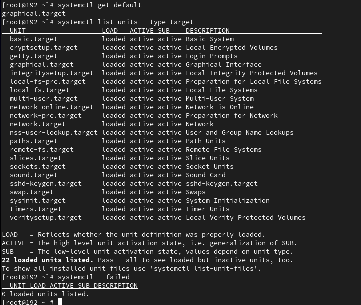 |
| 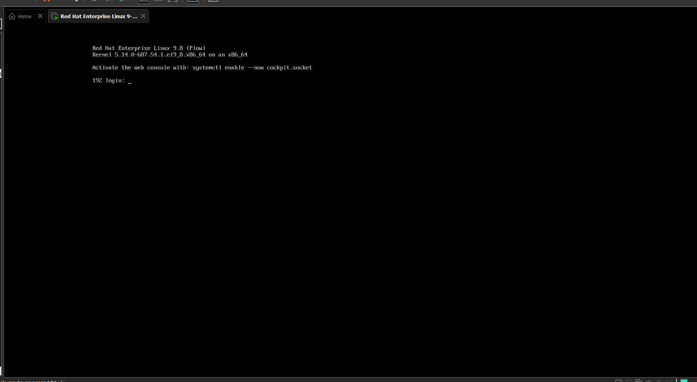 |
| 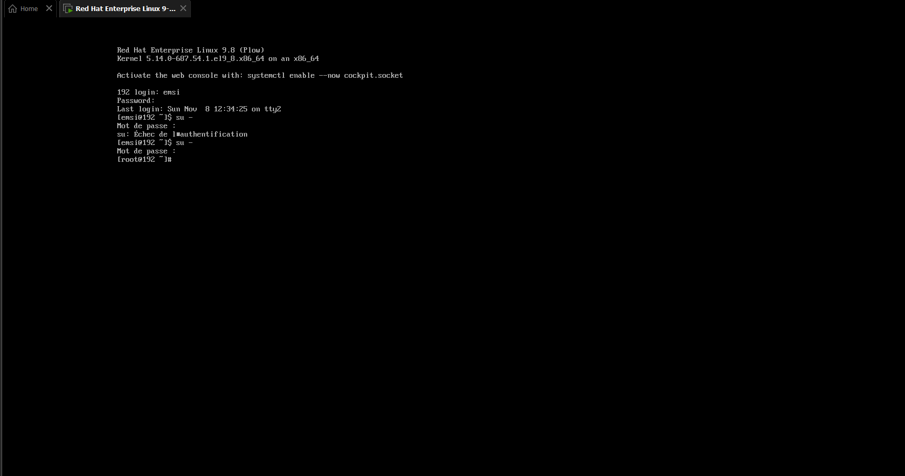 |
| 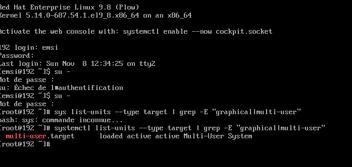 |

---

## Atelier 3 – Gestion des services avec systemctl

Service utilisé comme exemple : `sshd.service`.

| Commande | Rôle |
|---|---|
| `systemctl list-unit-files --type=service` | Lister les services et leur état (enabled, disabled, static, alias) |
| `systemctl status sshd.service` | État du service (`active (running)`) |
| `systemctl stop sshd.service` | Arrêt immédiat (`inactive (dead)`) |
| `systemctl start sshd.service` | Démarrage |
| `systemctl restart sshd.service` | Arrêt puis relance (nouveau PID) |
| `systemctl reload sshd.service` | Relecture de la configuration (SIGHUP, même PID) |
| `systemctl disable` / `enable sshd.service` | Supprimer / créer le lien de démarrage au boot |
| `systemctl is-enabled sshd.service` | Vérifier le démarrage automatique |
| `systemctl mask httpd.service` | Bloquer totalement un service (lien vers `/dev/null`) |
| `systemctl unmask httpd.service` | Lever le blocage |
| `systemctl kill sshd` | Envoyer un signal (SIGTERM) au service |

**Résultats :**
- `restart` change le PID (1370 → 6184), `reload` le conserve.
- `disable` supprime le lien dans `multi-user.target.wants`, `enable` le recrée.
- Un service masqué ne peut plus être démarré : `Failed to start httpd.service: Unit httpd.service is masked.`

| Capture |
|---|
| 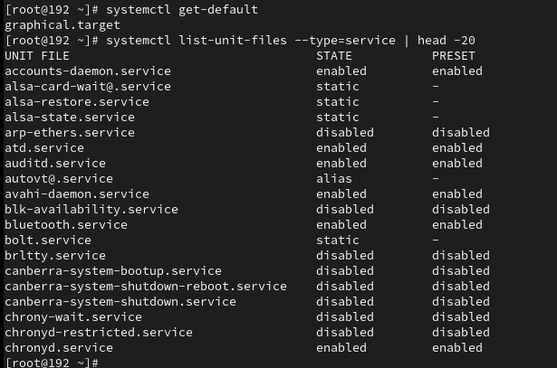 |
| 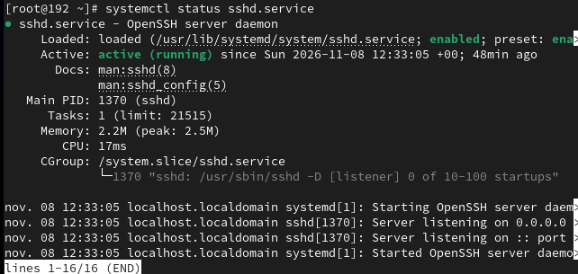 |
| 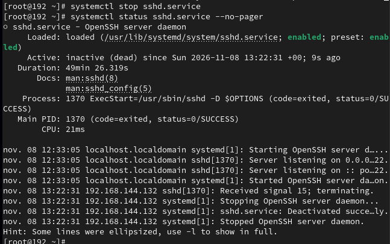 |
| 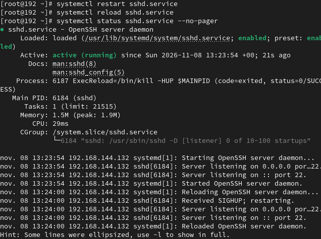 |
| 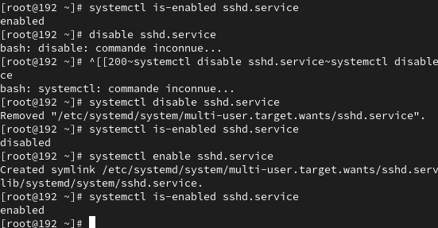 |
| 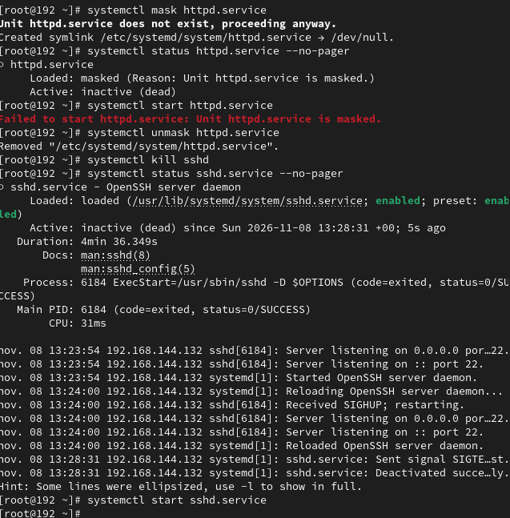 |

---

## Atelier 4 – Journalisation avec journalctl

| Commande | Rôle |
|---|---|
| `journalctl -b` | Journaux du dernier démarrage |
| `journalctl -f` | Logs en temps réel (Ctrl + C pour quitter) |
| `journalctl -u sshd.service` | Logs d'un service précis |
| `journalctl -p err` | Filtrer par priorité |
| `journalctl --since today` | Filtrer par date |
| `journalctl -n 20` | 20 dernières entrées |
| `journalctl -o json-pretty` | Format de sortie JSON détaillé (aussi `json`, `cat`, `verbose`) |

---

## Atelier supplémentaire – Service personnalisé

Fichiers : [`configs/custom_service.sh`](configs/custom_service.sh) et [`configs/custom_service.service`](configs/custom_service.service).

**Étapes :**
1. Créer le script dans `/usr/local/bin/custom_service.sh` et le rendre exécutable (`chmod +x`). Il écrit un message daté dans `/tmp/custom_service_output.txt`.
2. Créer `/etc/systemd/system/custom_service.service` (avec `Type=oneshot` et `RemainAfterExit=yes`, car le script se termine immédiatement).
3. Activer et démarrer :
   ```
   systemctl daemon-reload
   systemctl enable custom_service.service
   systemctl start custom_service.service
   ```
4. Redémarrer la VM (`reboot`) et vérifier que le service s'est lancé seul.

**Résultat :** après le redémarrage, le fichier `/tmp/custom_service_output.txt` contient une nouvelle ligne (14:08:18) et le service est `active (exited)`, ce qui confirme le démarrage automatique.

| Capture |
|---|
| 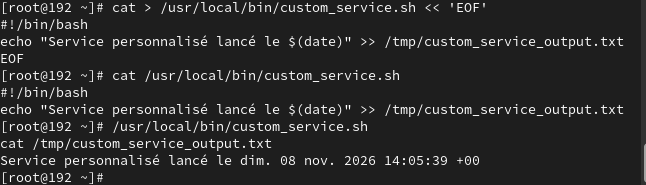 |
| 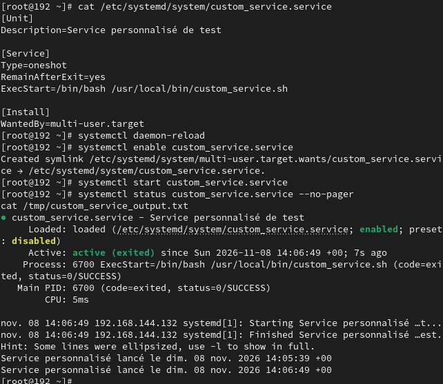 |
| 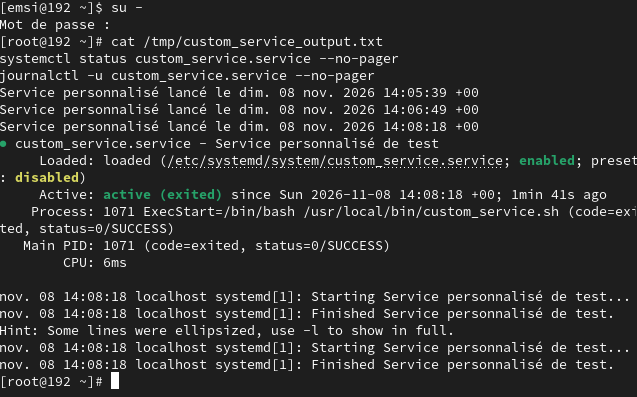 |

---

## Bilan

- `systemctl` : gérer les services et les cibles
- `journalctl` : consulter et filtrer les journaux
- `systemd-analyze` : analyser les performances du démarrage
- Services personnalisés : automatiser des tâches au démarrage
