# TP n°4 – Atelier 1 : Gestion de paquetages avec `rpm`


| | |
|---|---|
| **École** | EMSI – École Marocaine des Sciences de l'Ingénieur |
| **Module** | Administration Unix – 4IIR |
| **Encadrante** | Mme. Berraho Sanae |
| **Réalisé par** | *[Nom Prénom]* |
| **Année universitaire** | 2026/2027 |
| **Date de réalisation** | 13/11/2026 |
| **Environnement** | Red Hat Enterprise Linux 9 (machine virtuelle) |

---

## Table des matières

1. [Objectif](#1-objectif)
2. [Rappel : les options de `rpm`](#2-rappel--les-options-de-rpm)
3. [Questions 1 à 13](#3-réalisation-de-latelier)
4. [Conclusion](#4-conclusion)
5. [Structure du dossier](#5-structure-du-dossier)

---

## 1. Objectif

Maîtriser la gestion des paquetages sous Linux avec la commande `rpm` : interrogation de la base de données RPM, vérification, installation et désinstallation de paquetages, et compréhension de la gestion (limitée) des dépendances.

Toutes les commandes sont exécutées en **root**.

---

## 2. Rappel : les options de `rpm`

| Option | Rôle |
|--------|------|
| `-q` | Interroge un paquetage installé |
| `-a` | Tous les paquetages |
| `-i` (avec `-q`) | Affiche les informations du paquetage |
| `-l` | Liste les fichiers du paquetage |
| `-f <fichier>` | Trouve le paquetage auquel appartient un fichier |
| `-c` | Fichiers de configuration |
| `-p <fichier.rpm>` | Interroge un fichier `.rpm` non installé |
| `-V` | Vérifie les fichiers d'un paquetage par rapport à la base RPM |
| `-K` | Vérifie l'intégrité et la signature d'un `.rpm` |
| `-i` / `-v` / `-h` | Installe / mode verbeux / barre de progression |
| `-e` | Désinstalle (erase) |
| `--nodeps` | Ignore la vérification des dépendances |

---

## 3. Réalisation de l'atelier

### Question 1 – Liste des paquetages installés et leur nombre

```bash
rpm -qa
rpm -qa | wc -l
```

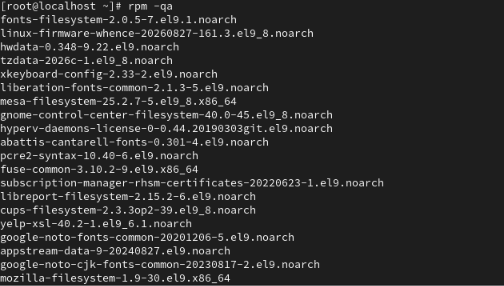

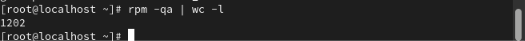

**Résultat :** le système compte **1202 paquetages** installés.

---

### Question 2 – Le paquetage `binutils` est-il installé ?

```bash
rpm -q binutils
rpm -qi binutils
```

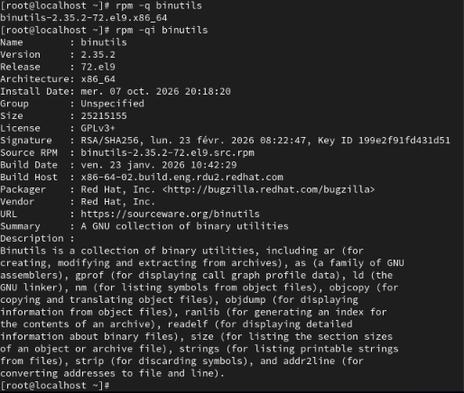

**Résultat :** oui, `binutils-2.35.2-72.el9.x86_64` est installé.

| Champ | Valeur |
|-------|--------|
| Version / Release | 2.35.2 / 72.el9 |
| Architecture | x86_64 |
| Date d'installation | mercredi 7 octobre 2026, 20:18:20 |
| Taille | 25 215 155 octets |
| Licence | GPLv3+ |
| Signature | RSA/SHA256, Key ID `199e2f91fd431d51` |
| Fournisseur | Red Hat, Inc. |
| Description | Collection d'utilitaires binaires (`ar`, `as`, `gprof`, `ld`, `nm`, `objcopy`, `objdump`, `ranlib`, `readelf`, `size`, `strings`, `strip`, `addr2line`) |

---

### Question 3 – Fichiers appartenant à `binutils`

```bash
rpm -ql binutils
```

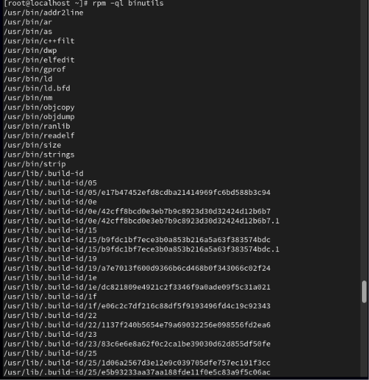

**Résultat :** le paquetage installe les exécutables dans `/usr/bin/` (`addr2line`, `ar`, `as`, `c++filt`, `dwp`, `elfedit`, `gprof`, `ld`, `ld.bfd`, `nm`, `objcopy`, `objdump`, `ranlib`, `readelf`, `size`, `strings`, `strip`), ainsi que de nombreux fichiers `/usr/lib/.build-id/…` (identifiants de compilation) et la documentation.

---

### Question 4 – Paquetage d'origine de `/etc/services`

```bash
rpm -qf /etc/services
```


**Résultat :** le fichier `/etc/services` provient du paquetage **`setup-2.13.7-10.el9.noarch`**.

---

### Question 5 – Fichiers modifiés de `nfs-utils` et `pam`

```bash
rpm -V nfs-utils pam
```

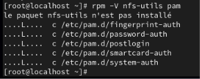

**Résultats :**

- `nfs-utils` : le paquetage **n'est pas installé** sur le système (message `le paquet nfs-utils n'est pas installé`), il n'y a donc rien à vérifier.
- `pam` : **5 fichiers de configuration** (`c`) présentent une différence, tous dans `/etc/pam.d/` :
  - `fingerprint-auth`
  - `password-auth`
  - `postlogin`
  - `smartcard-auth`
  - `system-auth`

**Interprétation du code `....L....` :** chaque caractère correspond à un test (`S` taille, `M` permissions, `5` somme MD5, `D` périphérique, `L` lien symbolique, `U` propriétaire, `G` groupe, `T` date, `P` capacités). Ici seul le `L` est actif : le **chemin du lien symbolique** diffère du fichier d'origine. Ces fichiers sont remplacés par des liens symboliques vers `/etc/authselect/` lorsque `authselect` gère la configuration d'authentification : la différence est donc normale et attendue.

---

### Question 6 – Téléchargement de `zsh` et fichiers de configuration

```bash
wget https://rpmfind.net/linux/centos-stream/10-stream/BaseOS/x86_64/os/Packages/zsh-5.9-14.el10.x86_64.rpm
rpm -qpc zsh-5.9-14.el10.x86_64.rpm
```

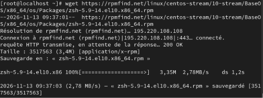

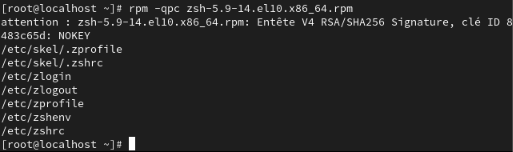

**Résultat :** le fichier `zsh-5.9-14.el10.x86_64.rpm` (3,4 Mo) est téléchargé. Les fichiers de configuration qui l'accompagnent sont :

- `/etc/skel/.zprofile`
- `/etc/skel/.zshrc`
- `/etc/zlogin`
- `/etc/zlogout`
- `/etc/zprofile`
- `/etc/zshenv`
- `/etc/zshrc`

L'avertissement `NOKEY` affiché correspond à la clé de signature non importée (voir question 7).

---

### Question 7 – Vérification de la signature électronique

```bash
rpm -K  zsh-5.9-14.el10.x86_64.rpm
rpm -Kv zsh-5.9-14.el10.x86_64.rpm
```

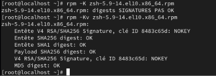

**Résultat :** `rpm -K` affiche `digests SIGNATURES PAS OK`. Le détail avec `-Kv` montre :

| Vérification | Résultat |
|--------------|----------|
| En-tête SHA256 digest | OK |
| En-tête SHA1 digest | OK |
| Payload SHA256 digest | OK |
| MD5 digest | OK |
| Signature V4 RSA/SHA256 (clé ID `8483c65d`) | **NOKEY** |

**Interprétation :** l'intégrité du fichier est confirmée (tous les *digests* sont OK), mais la signature ne peut pas être validée car la clé publique de **CentOS Stream** n'est pas importée sur ce système RHEL 9. L'authenticité du paquetage n'est donc pas garantie. Pour valider la signature, il faudrait importer la clé avec `rpm --import <clé GPG>`.

---

### Question 8 – Installation de `zsh` avec `--nodeps`

```bash
rpm -ivh --nodeps zsh-5.9-14.el10.x86_64.rpm
```

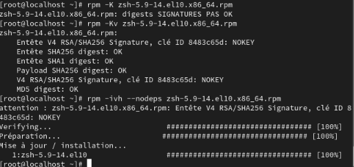

**Résultat :** l'installation réussit (`Verifying`, `Préparation`, `Mise à jour / installation : 1:zsh-5.9-14.el10` à 100 %). L'option `--nodeps` ignore la vérification des dépendances. Ce paquetage étant conçu pour CentOS Stream 10, son bon fonctionnement sur RHEL 9 n'est pas garanti : l'option doit être utilisée avec précaution.

---

### Question 9 – Vérification de l'installation

```bash
rpm -q zsh
```

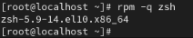

**Résultat :** `zsh-5.9-14.el10.x86_64` → le paquetage est bien installé.

---

### Question 10 – Fichiers fournis par `zsh`

```bash
rpm -ql zsh
```

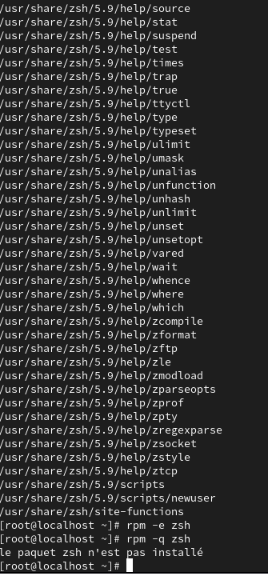

**Résultat :** `zsh` fournit de nombreux fichiers : exécutable, fichiers de configuration dans `/etc/`, modules, et surtout la documentation d'aide (`/usr/share/zsh/5.9/help/…`) et des scripts (`/usr/share/zsh/5.9/scripts/newuser`, `/usr/share/zsh/site-functions`).

---

### Question 11 – Désinstallation de `zsh`

```bash
rpm -e zsh
rpm -q zsh
```

*(Capture ci-dessus : voir la fin de la sortie.)*

**Résultat :** après `rpm -e zsh`, la commande `rpm -q zsh` répond `le paquet zsh n'est pas installé` : la désinstallation a réussi.

---

### Question 12 – Paquetage fournissant `/bin/ls`

```bash
rpm -qf /bin/ls
```

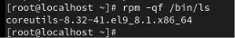

**Résultat :** la commande `/bin/ls` est fournie par le paquetage **`coreutils-8.32-41.el9_8.1.x86_64`**.

---

### Question 13 – Installation de `wireshark` avec `rpm`

Le paquetage a été téléchargé depuis un miroir Rocky Linux 9 (compatible RHEL 9), puis une installation a été tentée :

```bash
wget https://dl.rockylinux.org/pub/rocky/9/AppStream/x86_64/os/Packages/w/wireshark-3.4.10-9.el9_8.5.x86_64.rpm
rpm -ivh wireshark-3.4.10-9.el9_8.5.x86_64.rpm
rpm -q wireshark
```

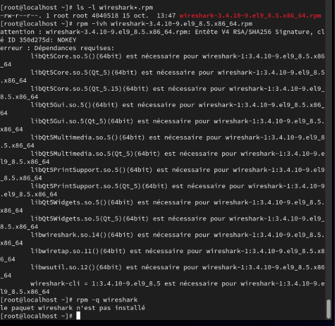

**Résultat :** l'installation **échoue** avec l'erreur `Dépendances requises`, et `rpm -q wireshark` confirme que le paquetage n'est pas installé.

Dépendances manquantes :

| Dépendance | Rôle |
|------------|------|
| `libQt5Core`, `libQt5Gui`, `libQt5Widgets`, `libQt5Multimedia`, `libQt5PrintSupport` | Bibliothèques Qt5 (interface graphique) |
| `libwireshark`, `libwiretap`, `libwsutil` | Bibliothèques internes de Wireshark |
| `wireshark-cli` | Outils en ligne de commande (`tshark`, `dumpcap`, …) |

**Pourquoi ne peut-on pas l'installer ?** La commande `rpm` ne résout pas les dépendances automatiquement : elle se contente de signaler les paquetages manquants. Il faudrait les télécharger et les installer manuellement, dans le bon ordre. Cette limite est levée par `dnf`/`yum`, qui calculent et installent automatiquement les dépendances à partir des dépôts (voir Atelier 2).

---

## 4. Conclusion

Cet atelier a permis de :

- **interroger la base RPM** (`-qa`, `-qi`, `-ql`, `-qf`) pour connaître les paquetages, leurs fichiers et l'origine d'un fichier ;
- **vérifier** l'état des fichiers installés (`-V`) et l'**intégrité/signature** d'un paquetage (`-K`) ;
- **installer et désinstaller** un paquetage (`-i`, `-e`) ;
- constater les **limites de `rpm`** : pas de résolution automatique des dépendances, ni de téléchargement depuis des dépôts. D'où l'intérêt de `dnf`/`yum`, objet de l'Atelier 2.

---

## 5. Structure du dossier

```
atelier1/
├── README.md                 ← ce compte rendu
├── commandes.sh              ← mémo de toutes les commandes utilisées
└── screenshots/
    ├── 01-rpm-qa.png
    ├── 02-rpm-qa-nombre.png
    ├── 03-binutils-informations.png
    ├── 04-binutils-fichiers.png
    ├── 05-etc-services-paquet.png
    ├── 06-verification-nfs-utils-pam.png
    ├── 07-telechargement-zsh.png
    ├── 08-zsh-fichiers-configuration.png
    ├── 09-zsh-signature.png
    ├── 10-zsh-installation.png
    ├── 11-zsh-verification.png
    ├── 12-zsh-fichiers-et-desinstallation.png
    ├── 13-bin-ls-paquet.png
    └── 14-wireshark-echec-dependances.png
```

⬅️ [Retour au sommaire du TP4](../README.md) · ➡️ [Atelier 2](../atelier2/README.md)
